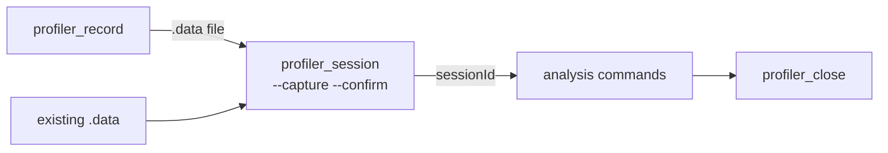
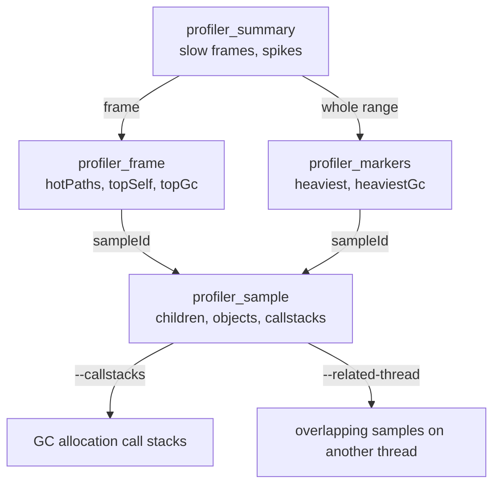
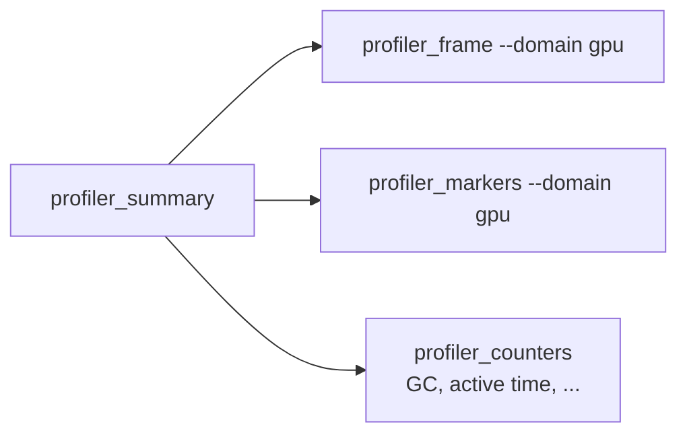

# Profiler capture analysis

`diagnostics profiler_*` commands that record a Unity Profiler capture (`.data`) and analyze it:
find slow frames, trace them to the responsible code, and read GPU time, counters and allocations.
Parameters and return shapes: [profiling-and-memory.md](../../../Documentation~/commands/profiling-and-memory.md).
Agent workflow: the `analyze-profiler-captures` skill.

## Lifecycle

`profiler_session` replaces the Editor's Profiler history, so it needs `--confirm`
(`--dry-run` previews). Reopening an open capture returns the same session and loads nothing.

## Finding the cause

## GPU and counters

GPU commands need a capture recorded with `profiler_record --areas GPU`.

## Commands

| Command | Use it to |
|---|---|
| `profiler_targets`, `profiler_connect` | Choose what to record: this Editor or a development Player. |
| `profiler_record`, `_status`, `_stop` | Record frames to a `.data` file. |
| `profiler_session`, `profiler_close` | Open a capture for analysis; release it. |
| `profiler_summary` | Rank frames, list spikes, and say CPU, GPU or GC bound. |
| `profiler_frame` | Hot paths and top markers of one frame. |
| `profiler_markers` | Aggregate markers over a frame range. |
| `profiler_sample` | Drill into one sample: children, Unity objects, callstacks. |
| `profiler_counters` | Counter statistics over a frame range. |

Maintainers: see [AGENTS.md](AGENTS.md).
